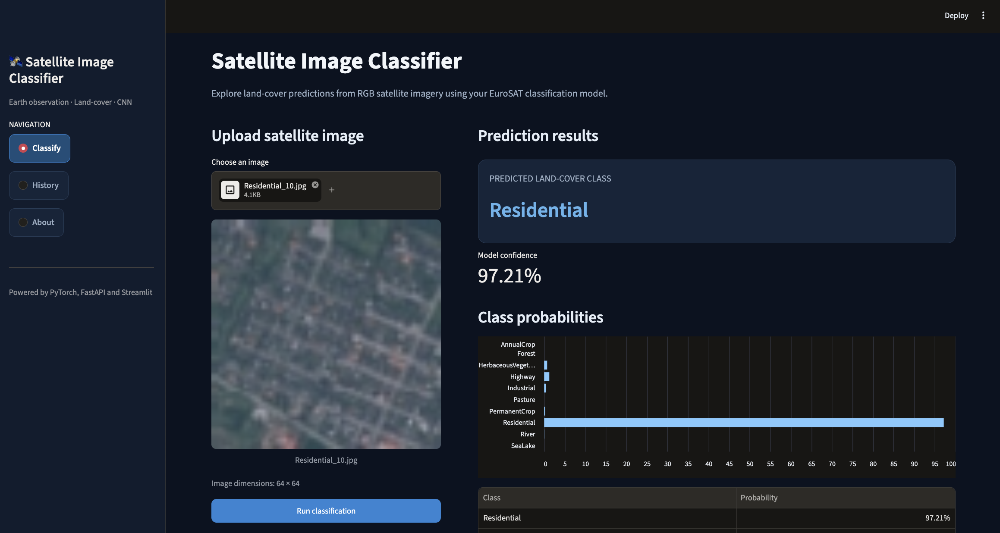
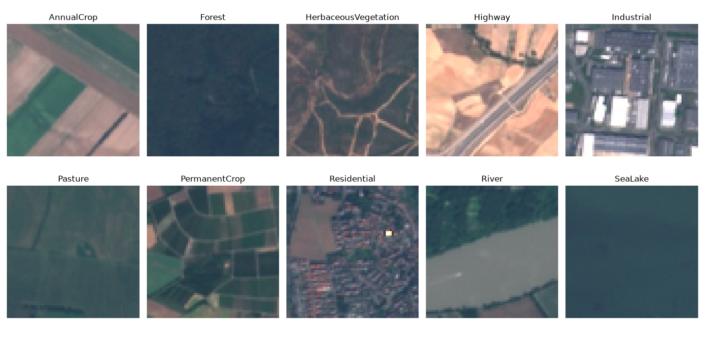
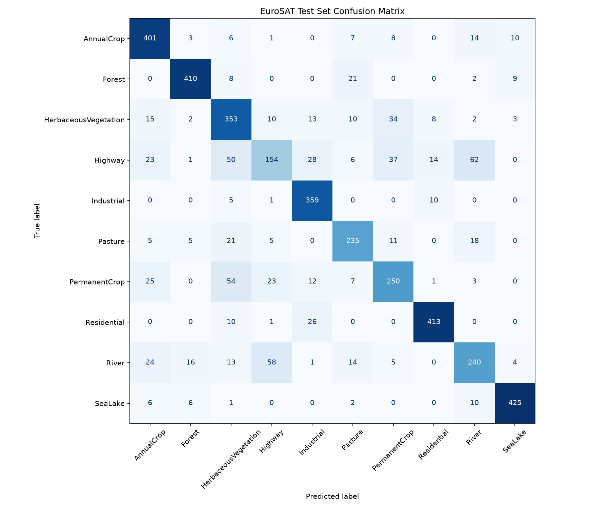

# Satellite Image Classification

 


A machine-learning pipeline for classifying satellite image patches into 10 land-cover categories using PyTorch and the EuroSAT Sentinel-2 RGB dataset.

The project combines deep learning, experiment tracking, model evaluation and API development to build a reproducible satellite image-classification application.

**Stack:** PyTorch · MLflow · FastAPI · Streamlit · Docker · Pytest · Ruff · GitHub Actions

## Table of contents

1. [Quick start](#quick-start)
2. [Local development](#local-development)
3. [Dataset](#dataset)
4. [Training](#training)
5. [Evaluation](#evaluation)
6. [Limitations and future improvements](#limitations-and-future-improvements)

<!-- ## Project Overview

The objective is to develop a small but reproducible deep-learning application for satellite image classification, covering the complete workflow from data preparation to model deployment.

Given a satellite image patch, a convolutional neural network (CNN) predicts its corresponding land-cover category.

The project covers the following stages:

- **Data exploration and preprocessing**: inspect image dimensions, class distributions and representative samples, then load RGB images, convert them into tensors and apply the necessary transformations.
- **Model development**: implement and train a CNN using PyTorch.
- **Experiment tracking**: record training parameters, metrics and artefacts with MLflow.
- **Model evaluation**: assess performance on a held-out test set using classification metrics.
- **API development**: serve model predictions through a REST API built with FastAPI, Uvicorn and Pydantic.
- **Interactive frontend**: develop a Streamlit web interface for uploading satellite images, visualising predictions and exploring class probabilities.
- **Containerisation**: package the application components using Docker.
- **Testing and code quality**: use Pytest for automated testing and Ruff for linting and formatting, with GitHub Actions to automate the testing and quality checks through continuous integration. -->

## Quick start

Run the full app (Streamlit frontend and FastAPI backend) with Docker. Requires Git and Docker (Desktop or Engine).

```bash
git clone https://github.com/ElisaLegnani/satellite-image-classifier.git
cd satellite-image-classifier
docker compose up --build
```

Then open the **Web app**: http://localhost:8501.

Upload a satellite image to see the predicted land-cover class and per-class confidence scores.



> This needs a trained model at `models/best_model.pth`. To train your own model, follow [Training](#training) first.

## Local development

```bash
python -m venv .venv
source .venv/bin/activate      # Windows: .venv\Scripts\activate
pip install ".[dev]"
```

Run the API without Docker:

```bash
uvicorn satellite_classifier.api:app --reload
```

**API docs** are available at: http://localhost:8000/docs.

Run tests and linting:

```bash
pytest
ruff check .
```

## Dataset

This project uses the [EuroSAT RGB dataset](https://github.com/phelber/EuroSAT), a publicly available satellite image dataset based on Sentinel-2 imagery. It contains 27,000 labelled image patches across 10 land-cover categories. Each image is 64 x 64 pixels with three colour channels (RGB).

The dataset is not included in this repository. Download and extract it into `data/EuroSAT_RGB/`.

To inspect and visualise the data:

```bash
python -m satellite_classifier.inspect_data
python -m satellite_classifier.visualize_data
```

Here is an example of the satellite image patches and their corresponding land-cover categories:



## Training

The classification model is implemented using a PyTorch CNN. The dataset is split 70/15/15 into training, validation and test sets.


```bash
python -m satellite_classifier.train
```

Hyperparameters (learning rate, batch size, epochs, seed, data-loading workers) are set in the training configuration. The best checkpoint on the validation set is saved to `models/best_model.pth`.

Runs are logged to MLflow. To compare experiments:

```bash
mlflow ui --backend-store-uri sqlite:///mlflow.db
```

Then open http://127.0.0.1:5000.

<!-- Add training curves? -->

## Evaluation

Run the evaluation on the test set:

```bash
python -m satellite_classifier.evaluate
```

The model is evaluated on a held-out test set (15% of the dataset, 4,050 images) using accuracy, per-class precision, recall and F1-score, and a confusion matrix.

| Metric | Test result |
|---|---|
| Accuracy | 0.80 |
| Macro precision | 0.79 |
| Macro recall | 0.79 |
| Macro F1-score | 0.79 |

Forest, Residential and SeaLake are classified most reliably (F1 ≥ 0.92). Highway is the weakest class (F1 0.49, recall 0.41), followed by River and PermanentCrop.

<details>
<summary>Per-class results</summary>

| Class | Precision | Recall | F1 | Support |
|---|---|---|---|---|
| AnnualCrop | 0.80 | 0.89 | 0.85 | 450 |
| Forest | 0.93 | 0.91 | 0.92 | 450 |
| HerbaceousVegetation | 0.68 | 0.78 | 0.73 | 450 |
| Highway | 0.61 | 0.41 | 0.49 | 375 |
| Industrial | 0.82 | 0.96 | 0.88 | 375 |
| Pasture | 0.78 | 0.78 | 0.78 | 300 |
| PermanentCrop | 0.72 | 0.67 | 0.69 | 375 |
| Residential | 0.93 | 0.92 | 0.92 | 450 |
| River | 0.68 | 0.64 | 0.66 | 375 |
| SeaLake | 0.94 | 0.94 | 0.94 | 450 |

</details>

<br>


## Limitations and future improvements

TBD